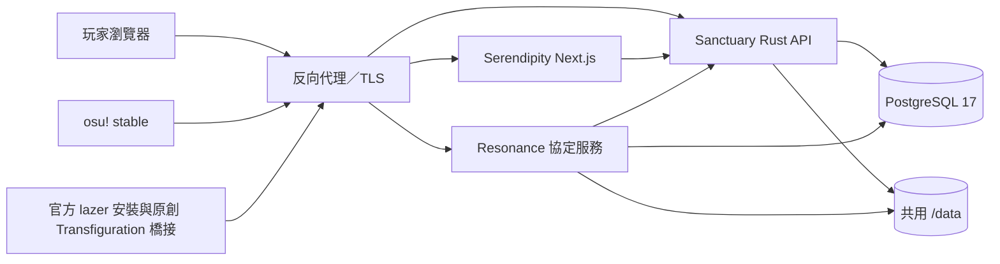

# Illyaverse 架構

Illyaverse 將玩家網站、社群 API、遊戲協定與遊戲啟動分成獨立服務。命名以伊莉雅的世界觀延伸：Serendipity 展示、Sanctuary 提供資料與權限、Resonance 接合客戶端協定、Kaleidoscope 管理指定 Illyaverse 部署的遊戲啟動與清理。The integration parent owns shared types, migrations and deployment composition, while the five products retain separate repository histories.

整合 checkout 位於 `osu-ps/Illyaverse`；五個主要子專案各有 repository 邊界，Illyaverse parent 透過 submodules 固定它們的版本。The parent origin is `Illyavrs/Illyaverse`, and the five registered submodule URLs and child origins use canonical HTTPS GitHub URLs under `Illyavrs`. Previous child bare origins remain as `local-cache`; the previous parent origin remains as `previous-origin`. Configuring these URLs does not establish a GitHub push, release, signing-key configuration or fresh-clone result. 根 `package.json` 管理 Serendipity 與 `tools/kaleidoscope/ui` 兩個 npm workspace；根 `Cargo.toml` 管理兩個服務、兩個共用 crate 與 Kaleidoscope 核心。Windows Tauri 外殼在 Kaleidoscope 的 `ui/src-tauri`，以 `../..` path dependency 使用同一核心；C# Transfiguration 有自己的 `.csproj`。共用 crates、migrations、lockfile、Compose 與整合文件留在 parent，Docker build 仍以完整 parent checkout 為 context。找程式碼與執行入口見 [資料夾導覽](repository-layout.md)。

| 服務 | 容器埠 | 健康檢查 | 負責資料／流程 |
| --- | --- | --- | --- |
| Serendipity | 3000 | `GET /` | Next.js standalone，三語介面，SWR API 請求與偏好呈現 |
| Sanctuary | 8080 | `/health/live`、`/health/ready` | 帳號 session、RBAC、譜面、媒體、score、replay、聊天與稽核 |
| Resonance | 8081 | `/health` | stable legacy endpoints／封包，lazer OAuth／API v2 子集 |
| PostgreSQL | 5432 | `pg_isready` | 全部持久化資料與 migration 狀態 |
| Caddy | 80／443 | `/healthz`，正式配置內部 `8088` | HTTPS、Host／path 路由、壓縮與上傳大小限制 |

Sanctuary 啟動時先連線 PostgreSQL、執行 migration，再處理可選的初始管理員與監聽。Compose 以真實 readiness 依序啟動 Resonance／Serendipity，再啟動 Caddy；Resonance 的獨立啟動也會檢查 migration。服務的 `/health/ready` 或 `/health` 都會讀取資料庫，避免把單純開啟 TCP 視為資料已可用。

## 資料與權限

`migrations/` 是 PostgreSQL schema 的版本來源，`crates/illya-domain` 放領域型別與驗證，`crates/resonance-protocol` 保持 pure wire code 可測試。查詢使用動態 SQLx，建置不需要連到真實資料庫。

網站權限由角色的 permission 字串授予。Sanctuary 會在 API 邊界核對 session、帳號限制與所需 permission；UI 的管理區域只是一層呈現。管理操作留下 audit events，角色／帳號／譜面／成績的敏感更動需對應權限。API 不應信任前端自行宣告的角色。

管理操作在交易取得鎖後重新驗證操作者登入與權限，避免排隊的舊請求在權限被撤銷後寫入。角色管理與登入撤銷只能操作其權限涵蓋的帳號；email 僅提供給持有帳號審核權限的人。角色刪除、最後管理員保護與管理 API 見 [權限文件](permissions.md)。

瀏覽器 cookie 以 `PUBLIC_ORIGIN` 驗證 mutating request；正式 Compose 強制 HTTPS 與 secure cookie。Sanctuary 信任的代理 CIDR 預設只涵蓋容器網路中 Caddy 與 Serendipity 的固定地址，避免直接客戶端透過任意 forwarded header 偽造來源。

Sanctuary 保存 `/data/media`、`/data/maps`、`/data/replays`。Resonance 把同一個 volume 掛載到同一個 `/data` 路徑，這樣資料庫中的檔案位置可由兩個服務讀取。兩個 Rust runtime 都使用 UID／GID `10001`，新 volume 的所有權一致；不把 volume 掛成公開靜態目錄，只有 API 指定的媒體與下載路由可讀取。

lazer 房間成績的原創程式碼已加入：PostgreSQL 保存不可變的 playlist 版本、每局 round 與凍結參與者、綁定的 score token、提交摘要及處理事件。Resonance 在呼叫 Sanctuary 前先保存提交內容，服務 HTTP 呼叫不跨越房間交易；完成後以同一交易連結分數與事件，再發送即時通知。房間查詢依每筆成績的凍結 round 授權，之後加入的玩家不會取得舊的私密成績；房間處理完成也不等於全域審核通過。目前僅支援建立 HeadToHead 房間。四項獨立 PostgreSQL／HTTP／WebSocket 測試及 19 項原生 DLL 資料模型檢查通過；實際原生遊戲與結果顯示仍待玩家驗證。詳見 [房間成績合約與驗證清單](lazer-room-scores-plan.md)。

## 路由與相容性

Caddy 將 `/api/v1/*` 與 `/media/*` 交給 Sanctuary，`/web/*`、`/osu/*`、`/d/*`、`/oauth/*`、`/api/v2/*` 與 `/signalr/*` 交給 Resonance，其餘網站請求交給 Serendipity。`c`／`ce`／`c4` 與 `spectator` 等協定 Host 直接交給 Resonance，避免遊戲請求落進 HTML 網站。Serendipity 的內部 rewrite 在 Docker build 時固定為 `http://sanctuary:8080`；SSR 的帳號語言讀取也使用 runtime `API_INTERNAL_URL`，由 Docker bridge DNS 解析服務名稱。

Resonance 與網站 Sanctuary 共用帳號／譜面／score 資料，並不代表每種客戶端協定都已完成。stable 的 encrypted submission、多人的生命週期與 spectator，以及 lazer 的 SignalR／score token／replay frames 各有獨立的實作與驗證狀態，必須逐項用真實客戶端確認。當前狀態以 [協定相容性文件](protocol-compatibility.md) 為準。

玩家使用 [Kaleidoscope 啟動器](kaleidoscope-launcher.md)，在 GUI 設定保存 Illyaverse 部署的 HTTPS 基底網址。每次啟動會固定本次網址；之後修改設定只影響下一次啟動。stable 帶入 `-devserver <設定的網域>`，使用 HTTPS 443；lazer 在遊戲入口前載入原創 Transfiguration 橋接，支援同一部署的自訂 HTTPS 連接埠。設定與外掛都拒絕官方 `ppy.sh` 及其子網域，連線失敗時也不會切回官方。相容性或必要修補失敗時拒絕啟動。

lazer 沿用目前安裝實際使用的圖譜庫，包括預設、portable 或自訂路徑的 `client.realm` 與 `files`；音訊、輸入、顯示與其他遊戲偏好從原本的 `game.ini` 載入並正常保存。只有七項登入與伺服器相關帳號快取另外存入同一資料目錄的 `auth.illyaverse.json`：`Username`、`Token`、`SaveUsername`、`SavePassword`、`WasSupporter`、`UserOnlineStatus`、`PMFriendsOnly`。私服帳號按正規化的 HTTPS origin 分開，切換網域或連接埠不會沿用另一部署的 token。官方帳號值不會載入私服 API，保存偏好時保留原有官方帳號行；舊的 `game.illyaverse.ini` 不會載入或遷移。

啟動器的控制與遊戲工作階段紀錄存於 `%LOCALAPPDATA%\Illyaverse\Kaleidoscope`；DLL 安裝與清理的復原紀錄 `.illyaverse-launcher.session.json` 則保存在使用中的圖譜庫 `rulesets` 目錄。監護程序在退出後只清理本次可核對身分且未被更換的 DLL。`rulesets` 內的新舊 lock 檔會一起取得並保留，以維持啟動器版本間的互斥；lock 檔存在本身不代表遊戲仍在執行。啟動器不修改 hosts／CA；本機 DNS／CA 和營運者 CLI 的規劃方式見[連線文件](connection.md)。

## 設計來源

[Solar-System](https://github.com/SunriseCommunity/Solar-System) 用於 monorepo／命名與權限架構研究；[bancho.py](https://github.com/osuAkatsuki/bancho.py) 與 [g0v0-server](https://github.com/GooGuTeam/g0v0-server) 用於客戶端接口行為研究；[ppy/osu](https://github.com/ppy/osu) 與官方協定文件用於 lazer endpoint 與 API 研究。沒有複製其實作程式碼。
